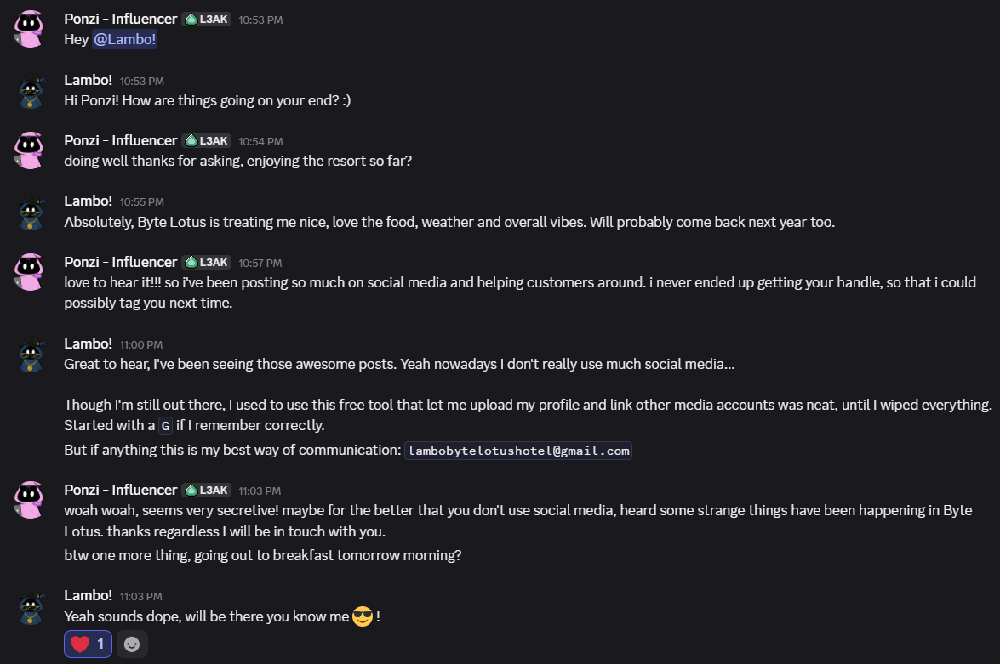
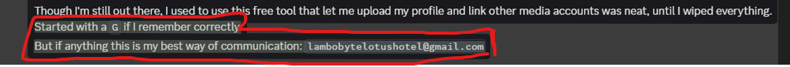
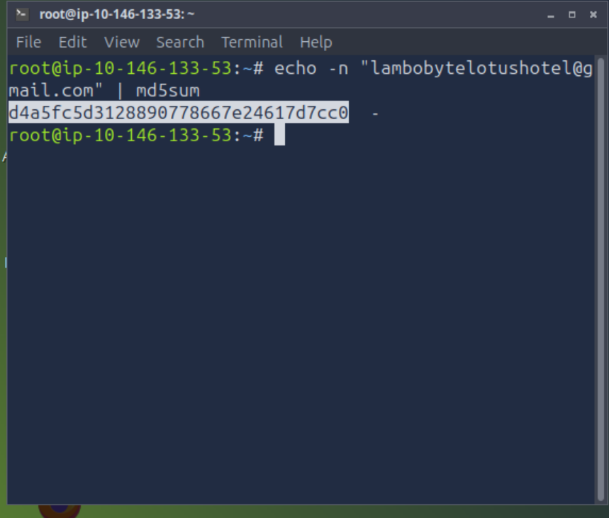
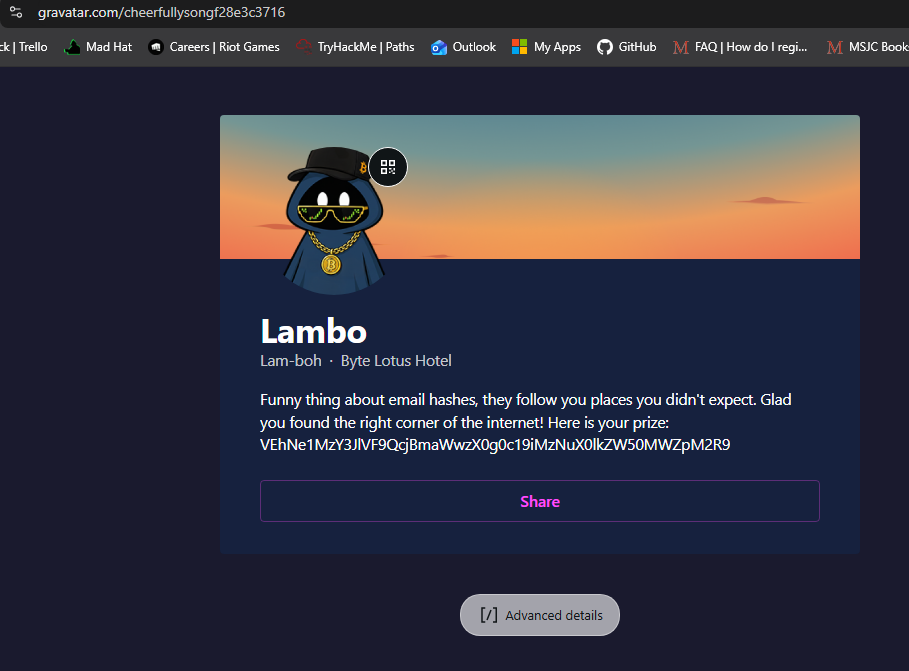
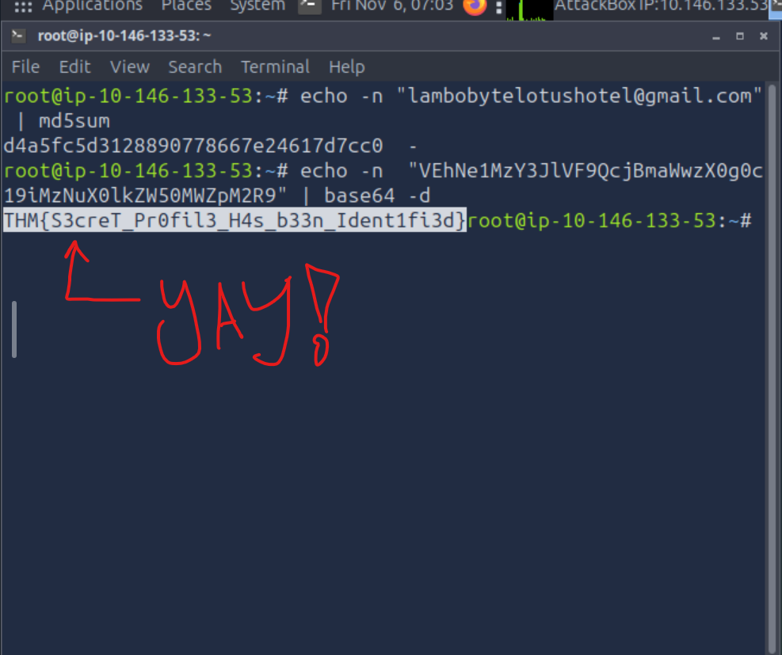

# Note: This was a time-limited TryHackMe event room. The link may no longer be active, but the write-up and screenshots below are permanent.

### Step 1: The screenshot of conversation 

This is the conversation I'm "overhearing." I need to look for a name, handle, or email.

### Step 2: Found it: lambobytelotushotel@gmail.com. "Started with a G" hint = Gravatar. I learned md5 hashing!

Found the hash. Now I go look it up in terminal.

### Step 3: The hash

Here's the hash. I'm gonna use it on gravatar to find the account.

### Step 4 Enter it all in my browser and find the account!

The account. [ I found The account and it had this: VEhNe1MzY3JlVF9QcjBmaWwzX0g0c19iMzNuX0lkZW50MWZpM2R9] / the event room says its 64 encoding and I need to decode it to get the answer I need to beat the room!

### Step 5 Enter the 64 encoding into terminal! Get the decoding and enter my answer into the room to finish! Yay!

I got it! :D echo "..." | base64 -d → spits out the flag. Pasted it in, beat the room. Yay!
